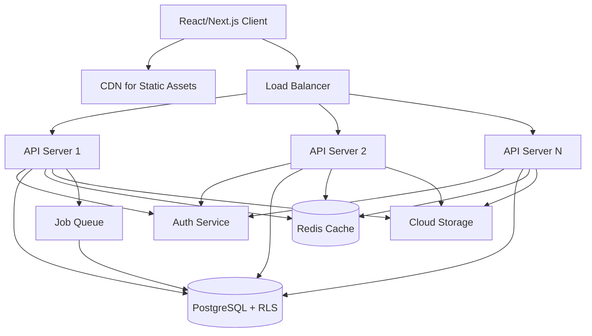
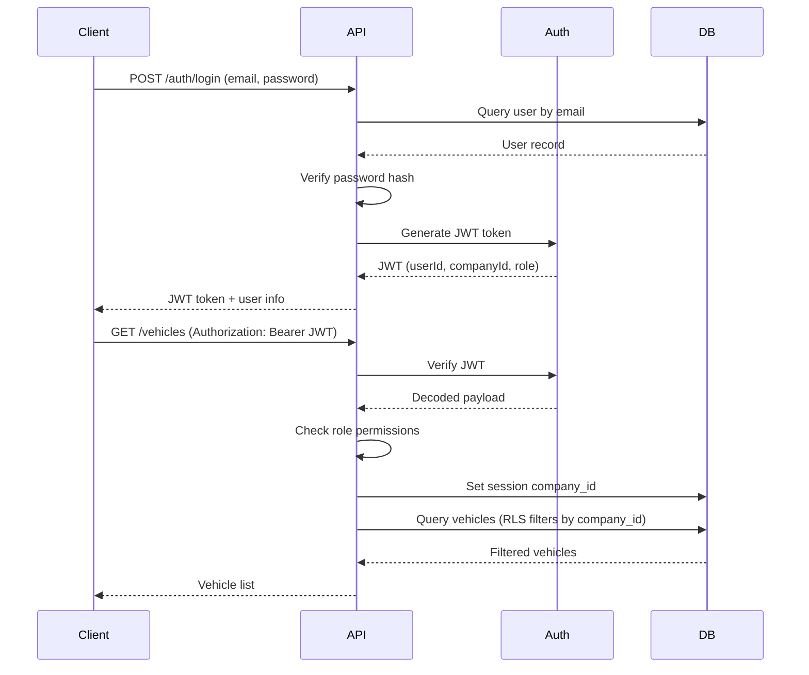

# Design Document

## Overview

The Enterprise Car Rental Management SaaS is a multi-tenant web platform built using a modern three-tier architecture. The system uses a pool-based multi-tenancy model where all companies share the same database schema with tenant isolation enforced through application-layer filtering and PostgreSQL Row-Level Security (RLS). The architecture prioritizes security, scalability, and maintainability while supporting complex business workflows for car rental operations.

The system is built with Node.js/Express backend, React/Next.js frontend, PostgreSQL database with Prisma ORM, and JWT-based authentication with role-based access control (RBAC).

## Architecture

### High-Level Architecture



### Multi-Tenancy Strategy

**Pool Model with Application-Layer Isolation:**
- All companies share the same database schema
- Every table containing tenant data includes a `company_id` column
- PostgreSQL Row-Level Security (RLS) policies enforce data isolation at database level
- Application middleware sets session variable `app.current_company_id` for RLS policies
- Prisma middleware automatically injects `company_id` filter on all queries

**Benefits:**
- Cost-efficient: Single database instance serves all tenants
- Simplified maintenance: Schema changes apply to all tenants
- Resource optimization: Shared connection pooling
- Scalability: Horizontal scaling of API servers

### Authentication and Authorization Flow



## Components and Interfaces

### Backend Components

#### 1. Authentication Service

**Responsibilities:**
- User registration and login
- Password hashing (bcrypt)
- JWT token generation and validation
- Session management
- Password reset flow

**Key Functions:**
```typescript
interface AuthService {
  register(email: string, password: string, role: Role, companyId: string): Promise<User>
  login(email: string, password: string): Promise<{ token: string, user: User }>
  verifyToken(token: string): Promise<TokenPayload>
  refreshToken(token: string): Promise<string>
  resetPassword(email: string): Promise<void>
}
```

#### 2. Multi-Tenant Middleware

**Responsibilities:**
- Extract company context from JWT
- Set PostgreSQL session variable for RLS
- Inject company_id into Prisma queries
- Prevent cross-tenant data access

**Implementation:**
```typescript
// Prisma middleware for automatic company_id injection
prisma.$use(async (params, next) => {
  const companyId = getCompanyIdFromContext()
  
  if (params.model && TENANT_MODELS.includes(params.model)) {
    if (params.action === 'findMany' || params.action === 'findFirst') {
      params.args.where = { ...params.args.where, company_id: companyId }
    }
    if (params.action === 'create') {
      params.args.data = { ...params.args.data, company_id: companyId }
    }
  }
  
  return next(params)
})
```

#### 3. RBAC Middleware

**Responsibilities:**
- Verify user has required permissions
- Enforce role-based access rules
- Block unauthorized actions

**Permission Matrix:**
```typescript
const PERMISSIONS = {
  SUPER_ADMIN: ['*'], // All permissions
  COMPANY_MANAGER: [
    'company:read', 'company:update',
    'branch:*',
    'vehicle:*',
    'booking:*',
    'rental:*',
    'customer:*',
    'driver:*',
    'employee:*',
    'financial:*',
    'reports:*'
  ],
  EMPLOYEE: [
    'booking:read', 'booking:create', 'booking:update',
    'rental:read', 'rental:create', 'rental:update',
    'customer:read', 'customer:create',
    'vehicle:read'
  ],
  DRIVER: [
    'rental:read',
    'profile:read', 'profile:update'
  ],
  CUSTOMER: [
    'booking:read', 'booking:create',
    'profile:read', 'profile:update'
  ]
}
```

#### 4. Vehicle Service

**Responsibilities:**
- CRUD operations for vehicles
- Vehicle availability checking
- Status management
- Maintenance tracking
- Profit calculation

**Key Functions:**
```typescript
interface VehicleService {
  createVehicle(data: VehicleInput): Promise<Vehicle>
  updateVehicle(id: string, data: Partial<VehicleInput>): Promise<Vehicle>
  checkAvailability(vehicleId: string, startDate: Date, endDate: Date): Promise<boolean>
  updateStatus(vehicleId: string, status: VehicleStatus): Promise<Vehicle>
  calculateProfit(vehicleId: string, startDate: Date, endDate: Date): Promise<number>
  transferBranch(vehicleId: string, toBranchId: string): Promise<Vehicle>
}
```

#### 5. Booking Service

**Responsibilities:**
- Create and manage bookings
- Detect scheduling conflicts
- Calculate pricing
- Apply discounts
- Status transitions

**Conflict Detection Algorithm:**
```typescript
// Check for overlapping bookings using interval overlap logic
// Two intervals [start1, end1] and [start2, end2] overlap if:
// start1 < end2 AND end1 > start2

async function hasConflict(
  vehicleId: string,
  startDate: Date,
  endDate: Date,
  excludeBookingId?: string
): Promise<boolean> {
  const conflicts = await prisma.booking.findMany({
    where: {
      vehicle_id: vehicleId,
      id: { not: excludeBookingId },
      status: { in: ['CONFIRMED', 'ACTIVE'] },
      AND: [
        { start_date: { lt: endDate } },
        { end_date: { gt: startDate } }
      ]
    }
  })
  
  return conflicts.length > 0
}
```

**Pricing Calculation:**
```typescript
function calculateBookingCost(
  vehicle: Vehicle,
  startDate: Date,
  endDate: Date,
  services: Service[],
  discountCode?: DiscountCode
): number {
  const days = differenceInDays(endDate, startDate)
  
  // Determine rate based on duration
  let baseRate: number
  if (days >= 30) {
    baseRate = vehicle.monthly_rate * Math.ceil(days / 30)
  } else if (days >= 7) {
    baseRate = vehicle.weekly_rate * Math.ceil(days / 7)
  } else {
    baseRate = vehicle.daily_rate * days
  }
  
  // Add services
  const servicesCost = services.reduce((sum, s) => sum + s.price, 0)
  
  // Apply discount
  let discount = 0
  if (discountCode) {
    discount = discountCode.type === 'PERCENTAGE'
      ? (baseRate * discountCode.value) / 100
      : discountCode.value
  }
  
  return baseRate + servicesCost - discount
}
```

#### 6. Rental Service

**Responsibilities:**
- Start and end rentals
- Calculate final charges
- Track odometer and fuel
- Generate invoices
- Handle late fees and damages

**Late Fee Calculation:**
```typescript
function calculateLateFee(
  expectedReturnDate: Date,
  actualReturnDate: Date,
  dailyRate: number
): number {
  if (actualReturnDate <= expectedReturnDate) return 0
  
  const lateDays = differenceInDays(actualReturnDate, expectedReturnDate)
  const LATE_FEE_MULTIPLIER = 1.5 // 150% of daily rate
  
  return lateDays * dailyRate * LATE_FEE_MULTIPLIER
}
```

**Mileage Fee Calculation:**
```typescript
function calculateMileageFee(
  startOdometer: number,
  endOdometer: number,
  includedMiles: number,
  perMileRate: number
): number {
  const actualMiles = endOdometer - startOdometer
  const extraMiles = Math.max(0, actualMiles - includedMiles)
  
  return extraMiles * perMileRate
}
```

#### 7. Financial Service

**Responsibilities:**
- Track revenue and expenses
- Generate financial reports
- Calculate profit/loss
- Invoice generation
- Payment tracking

**Key Functions:**
```typescript
interface FinancialService {
  recordRevenue(data: RevenueInput): Promise<Revenue>
  recordExpense(data: ExpenseInput): Promise<Expense>
  generateInvoice(rentalId: string): Promise<Invoice>
  calculateProfitLoss(startDate: Date, endDate: Date): Promise<ProfitLoss>
  getRevenueByVehicle(vehicleId: string, period: DateRange): Promise<number>
  getRevenueByBranch(branchId: string, period: DateRange): Promise<number>
  getRevenueByDriver(driverId: string, period: DateRange): Promise<number>
}
```

#### 8. Notification Service

**Responsibilities:**
- Send notifications via multiple channels
- Schedule recurring notifications
- Track notification delivery
- Template management

**Notification Triggers:**
```typescript
enum NotificationTrigger {
  MAINTENANCE_DUE = 'maintenance_due',
  INSURANCE_EXPIRY = 'insurance_expiry',
  RENTAL_OVERDUE = 'rental_overdue',
  LICENSE_EXPIRY = 'license_expiry',
  PAYMENT_OVERDUE = 'payment_overdue',
  BOOKING_CONFIRMED = 'booking_confirmed',
  RENTAL_STARTED = 'rental_started',
  RENTAL_COMPLETED = 'rental_completed'
}
```

#### 9. Analytics Service

**Responsibilities:**
- Calculate KPIs
- Generate dashboard metrics
- Performance rankings
- Trend analysis

**Key Metrics:**
```typescript
interface AnalyticsService {
  calculateFleetUtilization(companyId: string, date: Date): Promise<number>
  calculateCustomerRetention(companyId: string, period: DateRange): Promise<number>
  calculateAverageRentalDuration(companyId: string, period: DateRange): Promise<number>
  calculateRevenueGrowth(companyId: string, period: DateRange): Promise<number>
  calculateVehicleROI(vehicleId: string): Promise<number>
  rankDriverPerformance(companyId: string): Promise<DriverRanking[]>
}
```

**Fleet Utilization Formula:**
```typescript
function calculateFleetUtilization(
  totalVehicles: number,
  rentedVehicles: number
): number {
  if (totalVehicles === 0) return 0
  return (rentedVehicles / totalVehicles) * 100
}
```

**Driver Performance Score:**
```typescript
function calculateDriverPerformance(
  trips: number,
  averageRating: number,
  onTimePercentage: number
): number {
  return (trips * 0.4) + (averageRating * 0.3) + (onTimePercentage * 0.3)
}
```

#### 10. Audit Service

**Responsibilities:**
- Log all user actions
- Track data changes
- Security event logging
- Audit trail queries

**Audit Log Structure:**
```typescript
interface AuditLog {
  id: string
  user_id: string
  company_id: string
  action: string // 'CREATE', 'UPDATE', 'DELETE', 'LOGIN', 'LOGOUT'
  entity_type: string // 'Vehicle', 'Booking', 'Rental', etc.
  entity_id: string
  old_values?: Record<string, any>
  new_values?: Record<string, any>
  ip_address: string
  user_agent: string
  timestamp: Date
}
```

### Frontend Components

#### 1. Dashboard Component

**Displays:**
- Total fleet count
- Active rentals count
- Revenue metrics (today, month, year)
- Fleet utilization percentage
- Overdue rentals count
- Charts and visualizations

#### 2. Vehicle Management Component

**Features:**
- Vehicle list with filters
- Add/edit vehicle forms
- Document upload
- Status management
- Maintenance history
- Profit tracking

#### 3. Booking Management Component

**Features:**
- Calendar view of bookings
- Availability checker
- Booking form with conflict detection
- Status management
- Customer and driver assignment

#### 4. Rental Management Component

**Features:**
- Active rentals list
- Start rental form (odometer, fuel, contract)
- End rental form (return details, charges)
- Invoice generation
- Payment tracking

#### 5. Financial Reports Component

**Features:**
- Revenue charts
- Expense tracking
- Profit/loss reports
- Filterable by date, branch, vehicle
- Export functionality

## Data Models

### Core Entities

```prisma
// Multi-tenant companies
model Company {
  id                String    @id @default(uuid())
  name              String
  subscription_tier String
  is_active         Boolean   @default(true)
  created_at        DateTime  @default(now())
  updated_at        DateTime  @updatedAt
  
  branches          Branch[]
  users             User[]
  vehicles          Vehicle[]
  customers         Customer[]
  drivers           Driver[]
}

// Branches for multi-location support
model Branch {
  id          String   @id @default(uuid())
  company_id  String
  name        String
  address     String
  phone       String
  email       String
  is_active   Boolean  @default(true)
  created_at  DateTime @default(now())
  updated_at  DateTime @updatedAt
  
  company     Company  @relation(fields: [company_id], references: [id])
  vehicles    Vehicle[]
  employees   User[]
  
  @@index([company_id])
}

// Users with role-based access
model User {
  id          String   @id @default(uuid())
  company_id  String?
  branch_id   String?
  email       String   @unique
  password    String
  first_name  String
  last_name   String
  role        Role
  is_active   Boolean  @default(true)
  last_login  DateTime?
  created_at  DateTime @default(now())
  updated_at  DateTime @updatedAt
  
  company     Company? @relation(fields: [company_id], references: [id])
  branch      Branch?  @relation(fields: [branch_id], references: [id])
  audit_logs  AuditLog[]
  
  @@index([company_id])
  @@index([email])
}

enum Role {
  SUPER_ADMIN
  COMPANY_MANAGER
  EMPLOYEE
  DRIVER
  CUSTOMER
}

// Vehicles
model Vehicle {
  id                String        @id @default(uuid())
  company_id        String
  branch_id         String
  vin               String        @unique
  plate_number      String
  brand             String
  model             String
  year              Int
  fuel_type         String
  transmission      String
  status            VehicleStatus @default(AVAILABLE)
  daily_rate        Decimal       @db.Decimal(10, 2)
  weekly_rate       Decimal       @db.Decimal(10, 2)
  monthly_rate      Decimal       @db.Decimal(10, 2)
  current_odometer  Int
  current_fuel      Int           // Percentage 0-100
  purchase_cost     Decimal?      @db.Decimal(10, 2)
  created_at        DateTime      @default(now())
  updated_at        DateTime      @updatedAt
  deleted_at        DateTime?
  
  company           Company       @relation(fields: [company_id], references: [id])
  branch            Branch        @relation(fields: [branch_id], references: [id])
  bookings          Booking[]
  rentals           Rental[]
  maintenance_logs  MaintenanceLog[]
  documents         Document[]
  
  @@index([company_id])
  @@index([branch_id])
  @@index([vin])
  @@index([status])
}

enum VehicleStatus {
  AVAILABLE
  RESERVED
  RENTED
  MAINTENANCE
  OUT_OF_SERVICE
}

// Customers
model Customer {
  id                String    @id @default(uuid())
  company_id        String
  email             String
  first_name        String
  last_name         String
  phone             String
  license_number    String
  license_expiry    DateTime
  is_blacklisted    Boolean   @default(false)
  loyalty_level     String    @default("STANDARD")
  risk_score        Int       @default(50)
  total_spending    Decimal   @db.Decimal(10, 2) @default(0)
  created_at        DateTime  @default(now())
  updated_at        DateTime  @updatedAt
  
  company           Company   @relation(fields: [company_id], references: [id])
  bookings          Booking[]
  rentals           Rental[]
  documents         Document[]
  
  @@index([company_id])
  @@index([email])
}

// Professional drivers
model Driver {
  id                String    @id @default(uuid())
  company_id        String
  first_name        String
  last_name         String
  phone             String
  license_number    String
  license_expiry    DateTime
  total_trips       Int       @default(0)
  average_rating    Decimal   @db.Decimal(3, 2) @default(0)
  on_time_percentage Decimal  @db.Decimal(5, 2) @default(100)
  incidents_count   Int       @default(0)
  performance_score Decimal   @db.Decimal(5, 2) @default(0)
  is_active         Boolean   @default(true)
  created_at        DateTime  @default(now())
  updated_at        DateTime  @updatedAt
  
  company           Company   @relation(fields: [company_id], references: [id])
  bookings          Booking[]
  rentals           Rental[]
  documents         Document[]
  
  @@index([company_id])
}

// Bookings (reservations)
model Booking {
  id              String        @id @default(uuid())
  company_id      String
  vehicle_id      String
  customer_id     String
  driver_id       String?
  start_date      DateTime
  end_date        DateTime
  status          BookingStatus @default(PENDING)
  estimated_cost  Decimal       @db.Decimal(10, 2)
  discount_code   String?
  discount_amount Decimal       @db.Decimal(10, 2) @default(0)
  notes           String?
  created_at      DateTime      @default(now())
  updated_at      DateTime      @updatedAt
  
  vehicle         Vehicle       @relation(fields: [vehicle_id], references: [id])
  customer        Customer      @relation(fields: [customer_id], references: [id])
  driver          Driver?       @relation(fields: [driver_id], references: [id])
  services        BookingService[]
  rental          Rental?
  
  @@index([company_id])
  @@index([vehicle_id])
  @@index([start_date, end_date])
  @@index([status])
}

enum BookingStatus {
  PENDING
  CONFIRMED
  ACTIVE
  COMPLETED
  CANCELLED
  OVERDUE
}

// Active/completed rentals
model Rental {
  id                  String    @id @default(uuid())
  company_id          String
  booking_id          String    @unique
  vehicle_id          String
  customer_id         String
  driver_id           String?
  start_date          DateTime
  end_date            DateTime
  actual_return_date  DateTime?
  start_odometer      Int
  end_odometer        Int?
  start_fuel          Int
  end_fuel            Int?
  base_cost           Decimal   @db.Decimal(10, 2)
  late_fee            Decimal   @db.Decimal(10, 2) @default(0)
  mileage_fee         Decimal   @db.Decimal(10, 2) @default(0)
  damage_cost         Decimal   @db.Decimal(10, 2) @default(0)
  total_cost          Decimal   @db.Decimal(10, 2)
  status              String    @default("ACTIVE")
  created_at          DateTime  @default(now())
  updated_at          DateTime  @updatedAt
  
  booking             Booking   @relation(fields: [booking_id], references: [id])
  vehicle             Vehicle   @relation(fields: [vehicle_id], references: [id])
  customer            Customer  @relation(fields: [customer_id], references: [id])
  driver              Driver?   @relation(fields: [driver_id], references: [id])
  invoice             Invoice?
  documents           Document[]
  
  @@index([company_id])
  @@index([vehicle_id])
  @@index([status])
}

// Financial tracking
model Revenue {
  id          String    @id @default(uuid())
  company_id  String
  rental_id   String?
  type        String    // 'RENTAL', 'LATE_FEE', 'DAMAGE', 'SERVICE', 'DRIVER_CHARGE'
  amount      Decimal   @db.Decimal(10, 2)
  date        DateTime  @default(now())
  description String?
  created_at  DateTime  @default(now())
  
  @@index([company_id])
  @@index([date])
  @@index([type])
}

model Expense {
  id          String    @id @default(uuid())
  company_id  String
  vehicle_id  String?
  type        String    // 'MAINTENANCE', 'FUEL', 'INSURANCE', 'SALARY', 'PURCHASE'
  amount      Decimal   @db.Decimal(10, 2)
  date        DateTime  @default(now())
  description String?
  created_at  DateTime  @default(now())
  
  @@index([company_id])
  @@index([date])
  @@index([type])
}

model Invoice {
  id              String    @id @default(uuid())
  company_id      String
  rental_id       String    @unique
  invoice_number  String    @unique
  subtotal        Decimal   @db.Decimal(10, 2)
  tax_amount      Decimal   @db.Decimal(10, 2)
  total_amount    Decimal   @db.Decimal(10, 2)
  payment_status  String    @default("PENDING")
  payment_method  String?
  paid_at         DateTime?
  created_at      DateTime  @default(now())
  
  rental          Rental    @relation(fields: [rental_id], references: [id])
  
  @@index([company_id])
  @@index([invoice_number])
}

// Supporting entities
model MaintenanceLog {
  id          String    @id @default(uuid())
  vehicle_id  String
  type        String
  description String
  cost        Decimal   @db.Decimal(10, 2)
  date        DateTime
  next_due    DateTime?
  created_at  DateTime  @default(now())
  
  vehicle     Vehicle   @relation(fields: [vehicle_id], references: [id])
  
  @@index([vehicle_id])
  @@index([next_due])
}

model Document {
  id          String    @id @default(uuid())
  company_id  String
  entity_type String    // 'VEHICLE', 'CUSTOMER', 'DRIVER', 'RENTAL'
  entity_id   String
  type        String    // 'REGISTRATION', 'INSURANCE', 'LICENSE', 'CONTRACT', 'ID'
  file_url    String
  file_name   String
  uploaded_by String
  created_at  DateTime  @default(now())
  
  vehicle     Vehicle?  @relation(fields: [entity_id], references: [id])
  customer    Customer? @relation(fields: [entity_id], references: [id])
  driver      Driver?   @relation(fields: [entity_id], references: [id])
  rental      Rental?   @relation(fields: [entity_id], references: [id])
  
  @@index([company_id])
  @@index([entity_type, entity_id])
}

model Notification {
  id          String    @id @default(uuid())
  company_id  String
  user_id     String
  type        String
  title       String
  message     String
  is_read     Boolean   @default(false)
  sent_email  Boolean   @default(false)
  sent_sms    Boolean   @default(false)
  created_at  DateTime  @default(now())
  
  @@index([company_id])
  @@index([user_id, is_read])
}

model AuditLog {
  id          String    @id @default(uuid())
  company_id  String?
  user_id     String
  action      String
  entity_type String
  entity_id   String
  old_values  Json?
  new_values  Json?
  ip_address  String
  user_agent  String
  created_at  DateTime  @default(now())
  
  user        User      @relation(fields: [user_id], references: [id])
  
  @@index([company_id])
  @@index([user_id])
  @@index([created_at])
}

model BookingService {
  id          String    @id @default(uuid())
  booking_id  String
  name        String
  price       Decimal   @db.Decimal(10, 2)
  
  booking     Booking   @relation(fields: [booking_id], references: [id])
  
  @@index([booking_id])
}
```

## Correctness Properties

*A property is a characteristic or behavior that should hold true across all valid executions of a system—essentially, a formal statement about what the system should do. Properties serve as the bridge between human-readable specifications and machine-verifiable correctness guarantees.*


### Property 1: Multi-Tenant Data Isolation

*For any* company and any data query, the results should only include records where company_id matches the authenticated user's company, ensuring complete tenant isolation.

**Validates: Requirements 1.2**

### Property 2: Suspended Company Access Denial

*For any* user belonging to a suspended company, authentication attempts should fail with an appropriate error message.

**Validates: Requirements 1.3**

### Property 3: Company Activation Restores Access

*For any* previously suspended company that is activated, users of that company should be able to authenticate successfully.

**Validates: Requirements 1.4**

### Property 4: Global Analytics Access Control

*For any* user with role other than Super_Admin, attempts to access global analytics endpoints should return authorization errors.

**Validates: Requirements 1.5**

### Property 5: Super Admin Action Auditing

*For any* action performed by a Super_Admin user, an audit log entry with matching user_id, action, and timestamp should exist.

**Validates: Requirements 1.6**

### Property 6: Dashboard Completeness

*For any* Company_Manager accessing the dashboard, the response should include all required metrics: total fleet count, active rentals count, revenue metrics (today, month, year), fleet utilization percentage, and overdue rentals count.

**Validates: Requirements 2.1, 2.2, 2.3, 2.5**

### Property 7: Fleet Utilization Calculation

*For any* company at any point in time, the fleet utilization percentage should equal (count of vehicles with status RENTED / total count of vehicles) × 100.

**Validates: Requirements 2.4, 16.1**

### Property 8: Profit and Loss Calculation

*For any* date range, the profit/loss report should equal the sum of all revenue records minus the sum of all expense records for that period.

**Validates: Requirements 2.6, 7.13**

### Property 9: Driver Performance Score Formula

*For any* driver, the performance score should equal (total_trips × 0.4) + (average_rating × 0.3) + (on_time_percentage × 0.3).

**Validates: Requirements 2.8, 9.8**

### Property 10: Branch Creation and Association

*For any* branch created by a Company_Manager, querying that branch should return it with the correct company_id association.

**Validates: Requirements 3.1**

### Property 11: Branch Update Persistence

*For any* branch update operation, querying the branch afterward should return the updated values.

**Validates: Requirements 3.2**

### Property 12: Vehicle Transfer Updates Assignment

*For any* vehicle transferred from branch A to branch B, querying the vehicle afterward should show branch_id equal to B, and a transfer history record should exist.

**Validates: Requirements 3.3**

### Property 13: Branch Deletion Protection

*For any* branch with at least one rental in status ACTIVE, attempts to delete that branch should fail with an appropriate error.

**Validates: Requirements 3.5**

### Property 14: Vehicle Required Fields Validation

*For any* vehicle creation attempt missing VIN, plate_number, brand, model, year, fuel_type, or transmission, the operation should fail with a validation error.

**Validates: Requirements 4.1**

### Property 15: VIN Global Uniqueness

*For any* VIN value, attempting to create a second vehicle with the same VIN should fail with a uniqueness constraint error.

**Validates: Requirements 4.2**

### Property 16: Plate Number Company Uniqueness

*For any* plate number within a company, attempting to create a second vehicle with the same plate number in that company should fail with a uniqueness constraint error.

**Validates: Requirements 4.3**

### Property 17: Document Upload Persistence

*For any* document upload, querying documents afterward should return a record with a valid file_url that can be accessed.

**Validates: Requirements 4.4**

### Property 18: Vehicle Branch Assignment

*For any* vehicle assigned to a branch, querying the vehicle should return the correct branch_id.

**Validates: Requirements 4.5**

### Property 19: Pricing Storage Persistence

*For any* vehicle with pricing set, querying the vehicle should return the same daily_rate, weekly_rate, and monthly_rate values.

**Validates: Requirements 4.6**

### Property 20: Maintenance Status Booking Prevention

*For any* vehicle with status MAINTENANCE, attempts to create a booking for that vehicle should fail with an appropriate error.

**Validates: Requirements 4.8**

### Property 21: Vehicle Profit Calculation

*For any* vehicle and date range, the calculated profit should equal the sum of all revenue records for that vehicle minus the sum of all expense records for that vehicle in that period.

**Validates: Requirements 4.13**

### Property 22: Booking Conflict Detection

*For any* vehicle with an existing booking in status CONFIRMED or ACTIVE for date range [start1, end1], attempting to create a new booking for date range [start2, end2] where start2 < end1 AND end2 > start1 should fail with a conflict error.

**Validates: Requirements 5.2, 5.6**

### Property 23: New Booking Initial Status

*For any* newly created booking, the status should be PENDING.

**Validates: Requirements 5.3**

### Property 24: Cancelled Booking Releases Vehicle

*For any* booking that is cancelled, attempting to create a new booking for the same vehicle and overlapping date range should succeed (no conflict).

**Validates: Requirements 5.7**

### Property 25: Booking Cost Calculation

*For any* booking, the estimated_cost should equal (base_rate_for_duration + sum_of_service_prices - discount_amount).

**Validates: Requirements 5.11**

### Property 26: Overdue Booking Status Update

*For any* booking with status ACTIVE where current date is past end_date, the status should be updated to OVERDUE.

**Validates: Requirements 5.12**

### Property 27: Rental Start Updates Vehicle Status

*For any* rental that is started, the associated vehicle's status should be RENTED.

**Validates: Requirements 6.4**

### Property 28: Rental Duration Calculation

*For any* completed rental, the calculated duration should equal the difference in days between end_date and start_date.

**Validates: Requirements 6.6**

### Property 29: Late Fee Calculation

*For any* rental where actual_return_date is after end_date, the late_fee should be positive; for rentals returned on time or early, late_fee should be zero.

**Validates: Requirements 6.7**

### Property 30: Mileage Fee Calculation

*For any* rental, the mileage_fee should equal max(0, (end_odometer - start_odometer - included_miles) × per_mile_rate).

**Validates: Requirements 6.8**

### Property 31: Invoice Total Calculation

*For any* rental invoice, the total_amount should equal base_cost + late_fee + mileage_fee + damage_cost + tax_amount.

**Validates: Requirements 6.10**

### Property 32: Rental End Updates Vehicle Status

*For any* rental that is completed, the associated vehicle's status should be AVAILABLE.

**Validates: Requirements 6.11**

### Property 33: Revenue Per Vehicle Calculation

*For any* vehicle and date range, the calculated revenue should equal the sum of all revenue records where vehicle_id matches that vehicle in that period.

**Validates: Requirements 7.14**

### Property 34: Revenue Per Branch Calculation

*For any* branch and date range, the calculated revenue should equal the sum of all revenue records from rentals of vehicles assigned to that branch in that period.

**Validates: Requirements 7.15**

### Property 35: Revenue Per Driver Calculation

*For any* driver and date range, the calculated revenue should equal the sum of all revenue records from rentals where driver_id matches that driver in that period.

**Validates: Requirements 7.16**

### Property 36: Completed Rental Invoice Generation

*For any* rental with status COMPLETED, an invoice record with matching rental_id should exist.

**Validates: Requirements 7.17**

### Property 37: Invoice Tax Calculation

*For any* invoice, the tax_amount should equal subtotal × tax_rate.

**Validates: Requirements 7.18**

### Property 38: Customer Total Spending Calculation

*For any* customer, the total_spending should equal the sum of all total_cost values from rentals where customer_id matches that customer.

**Validates: Requirements 8.5**

### Property 39: Blacklisted Customer Booking Prevention

*For any* customer with is_blacklisted set to true, attempts to create a booking for that customer should fail with an appropriate error.

**Validates: Requirements 8.7**

### Property 40: Expired License Booking Prevention

*For any* customer where license_expiry is before the current date, attempts to create a booking for that customer should fail with an appropriate error.

**Validates: Requirements 8.10**

### Property 41: Expired Driver License Assignment Prevention

*For any* driver where license_expiry is before the current date, attempts to assign that driver to a rental should fail with an appropriate error.

**Validates: Requirements 9.4**

### Property 42: Driver Completed Trips Count

*For any* driver, the total_trips count should equal the number of rental records with status COMPLETED where driver_id matches that driver.

**Validates: Requirements 9.6**

### Property 43: Password Reset Invalidates Old Password

*For any* employee whose password is reset, authentication attempts with the old password should fail, and authentication with the new password should succeed.

**Validates: Requirements 10.4**

### Property 44: Employee Action Auditing

*For any* action performed by a user with role EMPLOYEE, an audit log entry with matching user_id, action, and timestamp should exist.

**Validates: Requirements 10.5**

### Property 45: Employee Financial Report Access Denial

*For any* user with role EMPLOYEE, attempts to access financial report endpoints should return authorization errors.

**Validates: Requirements 10.6**

### Property 46: Employee Delete Operation Denial

*For any* user with role EMPLOYEE, attempts to perform delete operations should return authorization errors.

**Validates: Requirements 10.7**

### Property 47: User Action Audit Logging

*For any* user action (create, update, delete, login), an audit log entry should exist with timestamp, user_id, action type, entity_type, and entity_id.

**Validates: Requirements 12.1**

### Property 48: Login Attempt Tracking

*For any* login attempt (successful or failed), an audit log entry with action LOGIN and success/failure status should exist.

**Validates: Requirements 12.2**

### Property 49: Soft Delete Behavior

*For any* record that is deleted, the record should have a non-null deleted_at timestamp, and normal queries should not return that record.

**Validates: Requirements 12.3**

### Property 50: Password Encryption

*For any* user, the stored password value should never equal the plaintext password provided during registration or update.

**Validates: Requirements 12.4**

### Property 51: Unauthorized Access Denial and Logging

*For any* API request without valid authentication or authorization, the request should be denied with an error response, and an audit log entry should be created.

**Validates: Requirements 12.7**

### Property 52: Session Timeout Enforcement

*For any* JWT token where the current time exceeds the token expiration time, authentication attempts using that token should fail with a token expired error.

**Validates: Requirements 12.8**

### Property 53: Permission-Based Access Control

*For any* action requiring permission P, users whose role does not include permission P should receive an authorization error when attempting that action.

**Validates: Requirements 13.4**

### Property 54: Privilege Escalation Prevention

*For any* user, attempts to modify their own role to a higher privilege level should fail with an authorization error.

**Validates: Requirements 13.7**

### Property 55: Input Validation Completeness

*For any* input validation failure (invalid VIN format, invalid email format, invalid phone format, negative numeric value where positive required, empty required field, start date after end date), the operation should fail and return a descriptive error message.

**Validates: Requirements 14.1, 14.2, 14.3, 14.4, 14.5, 14.6, 14.7, 14.8**

### Property 56: Document Unique Identifier Generation

*For any* two documents uploaded to the system, their document IDs should be different (unique).

**Validates: Requirements 15.6**

### Property 57: File Type Validation

*For any* document upload with a file type other than PDF, JPG, or PNG, the upload should fail with a validation error.

**Validates: Requirements 15.9**

### Property 58: File Size Validation

*For any* document upload where file size exceeds the configured maximum, the upload should fail with a validation error.

**Validates: Requirements 15.10**

### Property 59: Average Rental Duration Calculation

*For any* date range with N completed rentals, the average rental duration should equal (sum of all rental durations) / N.

**Validates: Requirements 16.3**

### Property 60: Revenue Growth Rate Calculation

*For any* two time periods (current and previous), the revenue growth rate should equal ((current_revenue - previous_revenue) / previous_revenue) × 100.

**Validates: Requirements 16.4**

### Property 61: Vehicle ROI Calculation

*For any* vehicle, the ROI should equal ((total_revenue - total_expenses) / purchase_cost) × 100.

**Validates: Requirements 16.5**

### Property 62: Rate Limiting Enforcement

*For any* API endpoint with rate limiting configured, after exceeding the allowed number of requests in the time window, subsequent requests should be rejected with a rate limit error.

**Validates: Requirements 17.9**

## Error Handling

### Error Categories

**1. Validation Errors (400 Bad Request)**
- Missing required fields
- Invalid data formats (email, phone, VIN, dates)
- Business rule violations (negative prices, invalid date ranges)
- File type/size violations

**2. Authentication Errors (401 Unauthorized)**
- Invalid credentials
- Expired JWT tokens
- Missing authentication token
- Suspended company access

**3. Authorization Errors (403 Forbidden)**
- Insufficient permissions for action
- Cross-tenant data access attempts
- Privilege escalation attempts

**4. Conflict Errors (409 Conflict)**
- Booking date conflicts
- Unique constraint violations (VIN, plate number, email)
- State transition violations (e.g., deleting branch with active rentals)

**5. Not Found Errors (404 Not Found)**
- Resource does not exist
- Soft-deleted records

**6. Rate Limit Errors (429 Too Many Requests)**
- Exceeded API rate limits

**7. Server Errors (500 Internal Server Error)**
- Database connection failures
- External service failures (cloud storage, email)
- Unexpected exceptions

### Error Response Format

```typescript
interface ErrorResponse {
  error: {
    code: string          // Machine-readable error code
    message: string       // Human-readable error message
    details?: any         // Additional context (validation errors, etc.)
    timestamp: string     // ISO 8601 timestamp
    request_id: string    // Unique request identifier for tracing
  }
}
```

### Error Handling Strategy

**Validation Errors:**
- Validate input at API boundary before processing
- Return all validation errors in a single response (not just first error)
- Include field names and specific validation rules violated

**Database Errors:**
- Catch unique constraint violations and return user-friendly messages
- Implement connection pooling and retry logic for transient failures
- Log all database errors for monitoring

**External Service Failures:**
- Implement circuit breaker pattern for cloud storage and email services
- Provide graceful degradation (e.g., queue emails for later if service down)
- Return appropriate errors to users without exposing internal details

**Audit Logging:**
- Log all errors with full context (user, action, input data)
- Never log sensitive data (passwords, tokens) in error logs
- Include stack traces in development, sanitize in production

## Testing Strategy

### Dual Testing Approach

The system will employ both unit testing and property-based testing to ensure comprehensive coverage:

**Unit Tests:**
- Verify specific examples and edge cases
- Test integration points between components
- Validate error conditions and boundary cases
- Test authentication and authorization flows
- Test API endpoints with specific inputs

**Property-Based Tests:**
- Verify universal properties across all inputs
- Test business logic with randomized data
- Validate calculations and formulas
- Test data integrity constraints
- Ensure multi-tenant isolation

Both testing approaches are complementary and necessary. Unit tests catch concrete bugs with specific scenarios, while property tests verify general correctness across the input space.

### Property-Based Testing Configuration

**Framework:** fast-check (for TypeScript/JavaScript)

**Configuration:**
- Minimum 100 iterations per property test
- Each test tagged with feature name and property number
- Tag format: `Feature: car-rental-management-saas, Property N: [property description]`

**Example Property Test:**
```typescript
import fc from 'fast-check'

// Feature: car-rental-management-saas, Property 22: Booking Conflict Detection
test('overlapping bookings should be rejected', async () => {
  await fc.assert(
    fc.asyncProperty(
      fc.record({
        vehicleId: fc.uuid(),
        start1: fc.date(),
        end1: fc.date(),
        start2: fc.date(),
        end2: fc.date()
      }).filter(({ start1, end1, start2, end2 }) => 
        start1 < end1 && start2 < end2 && start2 < end1 && end2 > start1
      ),
      async ({ vehicleId, start1, end1, start2, end2 }) => {
        // Create first booking
        await createBooking({ vehicleId, startDate: start1, endDate: end1, status: 'CONFIRMED' })
        
        // Attempt overlapping booking
        const result = await createBooking({ vehicleId, startDate: start2, endDate: end2 })
        
        // Should fail with conflict error
        expect(result.error).toBeDefined()
        expect(result.error.code).toBe('BOOKING_CONFLICT')
      }
    ),
    { numRuns: 100 }
  )
})
```

### Test Organization

**Unit Tests:**
- Co-located with source files using `.test.ts` suffix
- Organized by component/service
- Use descriptive test names explaining what is being tested

**Property Tests:**
- Separate directory: `tests/properties/`
- One file per major feature area
- Each property from design document implemented as separate test
- Clear comments linking test to design property number

### Testing Tools

- **Test Runner:** Jest or Vitest
- **Property Testing:** fast-check
- **API Testing:** Supertest
- **Database Testing:** In-memory PostgreSQL or test database
- **Mocking:** Minimal mocking - prefer real implementations where possible
- **Coverage:** Aim for >80% code coverage, 100% property coverage

### Continuous Integration

- Run all tests on every commit
- Run property tests with extended iterations (1000+) nightly
- Fail builds on test failures or coverage drops
- Generate and publish coverage reports

## Deployment Architecture

### Infrastructure Components

**Application Tier:**
- Multiple Node.js/Express API servers behind load balancer
- Horizontal auto-scaling based on CPU/memory metrics
- Health check endpoints for load balancer monitoring

**Database Tier:**
- PostgreSQL with Row-Level Security enabled
- Primary-replica setup for read scaling
- Automated backups with point-in-time recovery
- Connection pooling (PgBouncer)

**Caching Tier:**
- Redis for session storage and frequently accessed data
- Cache invalidation on data updates
- TTL-based expiration for analytics data

**Storage Tier:**
- Cloud object storage (AWS S3, Google Cloud Storage, Azure Blob)
- CDN for static assets and uploaded documents
- Signed URLs for secure document access

**Job Queue:**
- Background job processing for notifications, reports, analytics
- Retry logic for failed jobs
- Dead letter queue for persistent failures

### Security Measures

**Network Security:**
- HTTPS/TLS for all communications
- API rate limiting per user/IP
- DDoS protection via CDN/WAF
- Private network for database access

**Application Security:**
- JWT tokens with short expiration (15 minutes)
- Refresh tokens for extended sessions
- CORS configuration for allowed origins
- Input sanitization and validation
- SQL injection prevention via parameterized queries (Prisma)
- XSS prevention via output encoding

**Data Security:**
- Encryption at rest for database
- Encryption in transit (TLS)
- Password hashing with bcrypt (cost factor 12)
- Sensitive data masking in logs
- Regular security audits and penetration testing

### Monitoring and Observability

**Metrics:**
- API response times and error rates
- Database query performance
- Cache hit/miss rates
- Background job success/failure rates
- Resource utilization (CPU, memory, disk)

**Logging:**
- Structured logging (JSON format)
- Centralized log aggregation (ELK stack, CloudWatch, etc.)
- Log levels: ERROR, WARN, INFO, DEBUG
- Request tracing with correlation IDs

**Alerting:**
- High error rates
- Slow response times
- Database connection failures
- Disk space warnings
- Security events (failed logins, unauthorized access)

### Scalability Considerations

**Horizontal Scaling:**
- Stateless API servers for easy scaling
- Session data in Redis (not in-memory)
- Database read replicas for read-heavy operations

**Performance Optimization:**
- Database indexing on frequently queried columns
- Query optimization and EXPLAIN analysis
- Caching of expensive calculations (analytics, reports)
- Pagination for large result sets
- Lazy loading of related data

**Data Growth Management:**
- Archival strategy for old rentals and audit logs
- Partitioning of large tables by date
- Regular database maintenance (VACUUM, ANALYZE)

## Technology Stack Summary

**Frontend:**
- React 18+ or Next.js 14+
- TypeScript for type safety
- TailwindCSS for styling
- React Query for data fetching
- Recharts for analytics visualizations
- React Router for navigation

**Backend:**
- Node.js 20+ LTS
- Express.js for API framework
- TypeScript for type safety
- Prisma ORM for database access
- JWT (jsonwebtoken) for authentication
- bcrypt for password hashing
- fast-check for property-based testing
- Jest/Vitest for unit testing

**Database:**
- PostgreSQL 15+
- Row-Level Security (RLS) for multi-tenancy
- Prisma migrations for schema management

**Infrastructure:**
- Docker for containerization
- Docker Compose for local development
- Cloud provider (AWS/GCP/Azure) for production
- Redis for caching and sessions
- Cloud storage for documents
- CDN for static assets

**DevOps:**
- GitHub Actions / GitLab CI for CI/CD
- Automated testing in pipeline
- Automated deployments
- Infrastructure as Code (Terraform/CloudFormation)

## Conclusion

This design provides a comprehensive, production-ready architecture for an Enterprise Car Rental Management SaaS platform. The system prioritizes security through multi-tenant isolation, RBAC, and comprehensive audit logging. Scalability is achieved through horizontal scaling, caching, and efficient database design. The dual testing approach with both unit and property-based tests ensures correctness and reliability. The modular architecture allows for future enhancements and integrations while maintaining clean separation of concerns.
